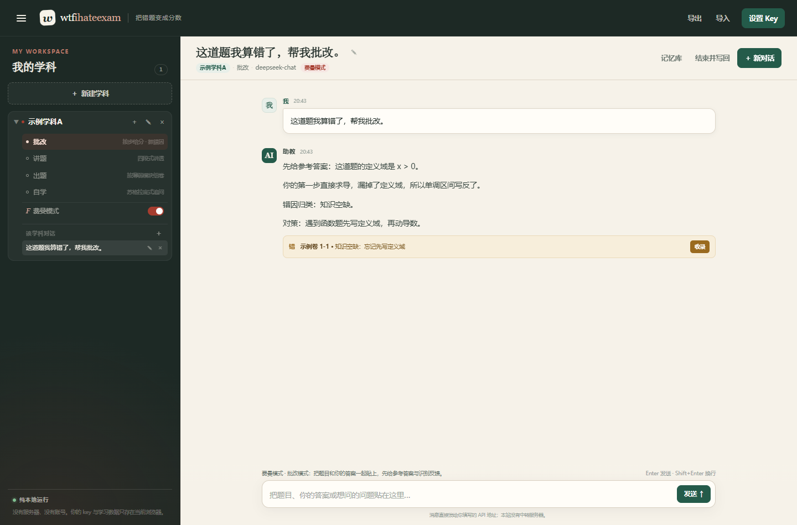
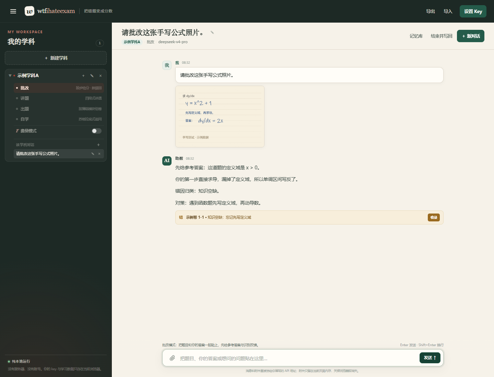

# wtfihateexam

> 把不会的题，变成会做的题。

一个**纯静态、零依赖、零构建**的 BYOK 学习工作台。打开网页，填入你自己的 DeepSeek API Key，就可以按学科整理错题、记录失分、和 AI 一起把薄弱点补上。

业务代码只有 `index.html`、`app.js`、`style.css` 三个文件，没有 npm、没有打包步骤、没有后端。第三方库都放在仓库里、不联网、不参与构建：`vendor/mammoth.browser.min.js` 把 `.docx` 转成纯文本，`vendor/katex/` 把模型输出的 LaTeX 渲染成正常公式，`vendor/pdfjs/` 在浏览器内读取 PDF 文字。改一句文案，用记事本就能完成。



> **在线地址**：<https://gatsmellow.github.io/wtfihateexam/>  
> **公开仓库**：<https://github.com/Gatsmellow/wtfihateexam>  
> 功能开发、本地验收与 GitHub Pages 部署均已完成。站点无服务器、无账号系统、无数据收集；API Key 只存在访问者自己的浏览器里。

---

## 它解决什么问题

刷题最怕的不是“不会”，而是：

- 错了就过去了，下次还错；
- 错题本记了一堆，不知道哪个模块最漏分；
- 问 AI 只得到一段答案，没有变成自己的理解。

wtfihateexam 把一次学习收束成一个闭环：

1. **选学科、选技能**：批改 / 讲题 / 出题 / 自学，再决定要不要打开费曼模式；
2. **贴题目聊**：AI 流式回复，按学科 rules 给反馈；
3. **结束并写回**：让 AI 把这场对话压缩成“错题新增 / 总账更新 / 考察清单”提案；
4. **逐项确认**：你勾选哪些，才写入哪些；
5. **看见变化**：错题本、失分总账、考察清单立刻更新；
6. **带走数据**：整个工作区一键导出 JSON，换电脑再导入。

## 快速开始

1. 打开在线地址 <https://gatsmellow.github.io/wtfihateexam/>（或本地运行，见下文）。
2. 点右上角 **设置 Key**。
3. 填自己的 DeepSeek API Key，点“保存设置”。Key 只保存在当前浏览器的 `localStorage`。
4. 在左侧新建学科，填入学科名和该学科的 rules（可留空）。
5. 选一个技能，把题目、你的答案或问题贴进输入框，发送。
6. 想让 AI 把结论沉淀下来时，点 **结束并写回**，逐项确认提案。

没有 Key 也能先建学科、写 rules、逛界面；点发送时会提示去填 Key。

## 功能

### 左侧：学科树

- **L1 学科**：新建、改名、编辑 rules、删除；每个学科下可以开多个对话。
- **L2 技能**：批改 / 讲题 / 出题 / 自学，单选，按对话保存。
- **L3 费曼模式**：开关，默认关闭；开启后在当前技能提示词后追加“你当学生、我当老师”的规则。
- **对话列表**：新建、切换、重命名、删除。

### 右侧：聊天

- 原生 `fetch` + `ReadableStream` 解析 DeepSeek 的 SSE 流，逐字显示。
- 支持停止生成（保留已生成的部分）。
- 渲染标题、列表、引用、代码块、粗体、链接；所有模型输出先转义，不执行 HTML。
- **公式渲染**：模型按常见 Markdown 习惯输出 `\(...\)`（行内）、`\[...\]` 或 `$$...$$`（独立成行）的 LaTeX，页面用本地 KaTeX 排版成正常公式；纯文本里的 `$...$` 不强行识别，避免把价格或普通符号误当公式。渲染失败时退回等宽原文，不吞内容。
- AI 按约定输出 `【错题卡】{...}` 时，会显示成可收录的卡片；错因里的公式也会排版。
- **图片 / 文档附件**：输入框左侧的回形针可一次选择多张图片（png / jpg / jpeg / webp）或文档（txt / md / csv / json / html / xml / pdf / doc / docx / ppt / pptx）；截图也可以直接 Ctrl+V 粘贴。图片以缩略图、文档以文件名显示在消息里，发送前可以逐个移除。图片按 OpenAI 多模态格式以 base64 data URL 发给 API；文档在浏览器内提取为纯文本，再随消息发给 API。DeepSeek 官方目前只有 `deepseek-flash` 支持读图，`deepseek-v4-pro` 只处理文字；当前模型不支持图片时会提示切换。官方能力说明：[DeepSeek 图像理解](https://api-docs.deepseek.com/zh-cn/guides/vision/)。
- **文档提取边界**：PDF 只提取内嵌文字，扫描件（纯图片 PDF）没有 OCR，会提示改传图片；`.docx` 用本地 mammoth；`.pptx` 和 `.pdf` 用仓库内库解析；旧版 `.doc` / `.ppt` 是 OLE 二进制，浏览器只能尽力提取文字，表格、图片和版式可能缺失，页面会明确标注，建议优先另存为 `.docx` / `.pptx` / PDF。
- 附件在内存里处理，不经过任何转换服务器；页面上限为单文件 8 MB、一次 8 个附件。




### 记忆库

- **错题本**：题号、错因、对策、状态（待复习 / 复习中 / 已掌握），状态可点击切换。
- **失分总账**：总失分、总满分、失分率、待复习数量；按模块用表格和进度条展示。
- **考察清单**：待办 / 进行中 / 已办。
- 支持手动添加、编辑、删除条目。

### 关账（结束并写回）

点聊天页右上角 **结束并写回**：

1. 把当前对话发给模型，要求只返回 JSON：
   ```json
   {
     "错题新增": [],
     "总账更新": [],
     "队列更新": []
   }
   ```
2. 弹窗按三组逐项列出，默认勾选，可取消；
3. 只有你点确认，勾选项才写入；错题按题号去重，总账按模块合并，清单按事项合并；
4. 取消则只保留对话，不改记忆库。

### 设置

- API base URL，默认 `https://api.deepseek.com/v1`；
- 模型名，默认 `deepseek-chat`；读图需要支持 vision 的模型，DeepSeek 官方用 `deepseek-flash`（`deepseek-v4-pro` 不支持图片）；
- API Key，仅存当前浏览器 `localStorage`；
- “测试连接”会请求 `/models` 并显示结果；
- 调试开关：打开后发送消息时在控制台打印完整 system prompt，方便观察技能和费曼的变化。

### 导入 / 导出

- **导出**：把学科、rules、错题、总账、考察清单、所有对话打包为 JSON 下载；**不包含 API Key**。
- **导入**：覆盖当前浏览器里的工作区，导入前会二次确认；导入后自动打开最近一个对话。

## 数据与隐私

> **你的 key 和数据只存在你自己的浏览器，本站无服务器、无任何数据收集。**

更具体地说：

- API Key 只写入 `localStorage['wtfihateexam.apiKey']`，不会发给本站作者，也不会进入导出文件。
- 学科、rules、错题、总账、考察清单、对话都存在浏览器的 **IndexedDB**（数据库名 `wtfihateexam`）；IndexedDB 不可用时降级到 `localStorage`。
- 聊天请求由浏览器**直接**发往你填写的 API base URL（默认 DeepSeek）。本站没有后端转发，不记录请求。
- 图片与文档附件**只留在当前页面内存**：不写入 IndexedDB / localStorage，不进入导出文件；刷新或关闭页面即消失。文字消息仍会正常保存。
- 没有统计脚本、没有 Cookie、没有 CDN；docx、PDF、PPTX 解析库和 KaTeX 公式库（含字体）都是仓库内的本地文件，不从网络加载。
- 清空浏览器站点数据会丢失本地工作区，请定期用“导出”备份。

## 本地运行

推荐起一个静态服务器（`file://` 下部分浏览器会限制 IndexedDB 和跨域请求）：

```bash
cd web
python -m http.server 8000
```

然后打开 <http://127.0.0.1:8000/>。

没有 Python 也可以直接双击 `index.html`；存储会自动降级，但 API 跨域行为取决于浏览器和 API 服务。

### 验证 DeepSeek CORS

`docs/test-cors.html` 是阶段零的跨域侦察页：填入 Key，点按钮，页面会用带 `Authorization` 头的请求访问 `/models`，显示状态码、响应头和模型列表。Key 只存在内存，刷新即消失。

阶段零的实测结论：DeepSeek 的预检响应允许 `authorization` 和 `content-type` 请求头；无有效 Key 时浏览器能读到 `401` 和响应头，说明 CORS 本身没有拦截。真实 Key 的 `200` 与模型列表请用你自己的 Key 在该页复验。

## 自定义（不用写代码）

### 改五段提示词

用记事本打开 `app.js`，顶部就是五段模板常量（约第 34–78 行）：

- `PROMPT_PIGAI`：批改
- `PROMPT_JIANGTI`：讲题
- `PROMPT_CHUTI`：出题
- `PROMPT_ZIXUE`：自学
- `PROMPT_FEYNMAN`：费曼模式追加段

它们都是普通中文字符串，直接改文字即可。保存后刷新网页生效。

最终 system prompt 的拼接顺序是：

```text
技能模板
→ 费曼追加段（若开启）
→ 【当前学科】
→ 记忆摘要（错题 / 总账 / 考察清单）
→ 【本学科 rules】
```

学科 rules 永远在最后，方便覆盖前面的通用要求。

### 改配色和文案

- 颜色、字号、间距：`style.css` 顶部的 `:root` CSS 变量。
- 页面文案和结构：`index.html`。
- 无需安装任何工具，改完刷新即可。

## 文件结构

```text
web/
├── index.html          # 页面结构（无外链依赖）
├── app.js              # 五段提示词、IndexedDB、聊天、关账、导入导出
├── style.css           # 全部样式（含手机端适配）
├── README.md
├── LICENSE             # MIT
├── .nojekyll           # 告诉 GitHub Pages 不要走 Jekyll
├── .gitignore
├── .gitattributes
├── docs/
│   ├── screenshot.png  # 主界面截图
│   ├── attachment.png  # 图片 / 文档附件截图
│   ├── documents.png   # PDF / PPTX / DOCX 附件截图
│   ├── math.png        # 公式渲染截图
│   ├── no-key.png      # 无 Key 引导页截图
│   ├── cors-check.png  # 阶段零 CORS 实测截图（401 也带 CORS 头）
│   └── test-cors.html  # 阶段零跨域侦察页（留档）
└── vendor/
    ├── mammoth.browser.min.js  # 本地 docx→纯文本库（不联网）
    ├── mammoth.LICENSE.txt     # BSD-2-Clause
    ├── katex/                  # 本地 KaTeX 0.16.22（公式渲染，不联网）
    │   ├── katex.min.js
    │   ├── katex.min.css
    │   ├── LICENSE             # MIT
    │   └── fonts/*.woff2
    └── pdfjs/                  # 本地 PDF.js 3.11.174（PDF 取字，不联网）
        ├── pdf.min.js
        ├── pdf.worker.min.js
        ├── LICENSE             # Apache-2.0
        ├── cmaps/*.bcmap
        └── standard_fonts/*
```

## 部署到 GitHub Pages

本项目已经部署在：

- 在线访问：<https://gatsmellow.github.io/wtfihateexam/>
- 仓库地址：<https://github.com/Gatsmellow/wtfihateexam>

当前 Pages 配置为 `main` 分支、根目录 `/ (root)`。如果要复刻一份：

1. 新建 GitHub 仓库 `wtfihateexam`；
2. 把本目录（`web/` 里的内容）推到 `main` 分支根目录；
3. 仓库 **Settings → Pages**：Source 选 `Deploy from a branch`，分支 `main`，目录 `/ (root)`；
4. 等 Pages 构建完成，访问 `https://<用户名>.github.io/wtfihateexam/`。

因为根目录有 `index.html`，且前端全是相对路径，不需要任何构建配置。`.nojekyll` 已放好。

## 技术约定

- 无框架、无构建、无 CDN、无远程第三方脚本；docx 用仓库内本地 mammoth，PPTX 用浏览器原生 `DecompressionStream` + XML 解析，PDF 用仓库内本地 PDF.js，公式用仓库内本地 KaTeX。
- 模型输出先统一转义；Markdown 只生成受控标签，LaTeX 交给 KaTeX（`trust: false`），不执行模型给出的 HTML。
- 所有业务代码在一个 `app.js` 里，按“常量 → 存储 → 提示词 → API → 渲染 → 交互 → 导入导出”分段；附件逻辑在 API 和渲染之间，以内存 Map 维护。
- 数据只存本地；所有网络请求由用户浏览器直连用户配置的 API。
- 代码注释使用中文。

## 明确不做（留给 v2）

- 产物分叉修复子对话；
- 思维导图生成；
- 规则市场 / 分享；
- 后端与账号系统。

## License

MIT。示例数据仅用于演示，仓库不包含任何真实用户数据。
